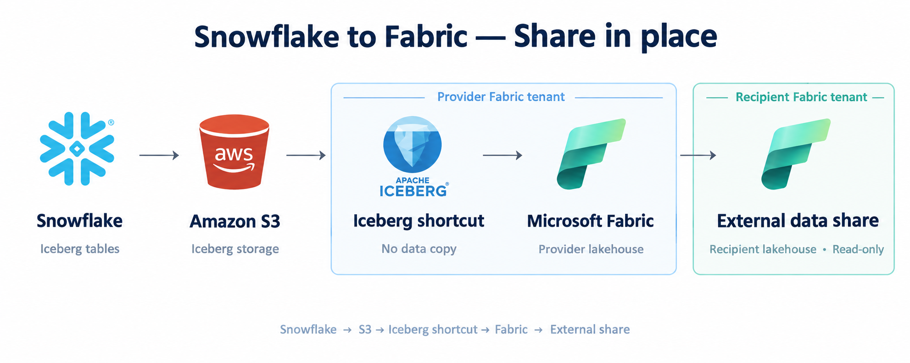

# icebergs3-to-fabric

**Read Snowflake-managed Iceberg tables on Amazon S3 in Microsoft Fabric, then share a table across Fabric tenants without a copy pipeline.**

This guide is for teams already comfortable with AWS IAM, S3, and Snowflake but new to Microsoft Fabric. It provides UI and programmatic Fabric walkthroughs, reusable AWS policy, Snowflake SQL, and Fabric REST templates, and acceptance checks. It is a reference implementation, not a turnkey installer or production certification.

You can use an existing compatible Iceberg table and skip the sample source setup. AWS Glue, Athena, EMR, and Snowflake Open Catalog are not required for this architecture.

## Architecture

### At a glance



### Detailed view

```mermaid
flowchart LR
    subgraph AWS["AWS / Snowflake"]
        SF["Snowflake-managed Iceberg table"]
        ROLE["Scoped writer IAM role<br/>Snowflake principal + external ID"]
        S3[("Customer-owned S3<br/>Iceberg metadata + Parquet")]
        SF -->|"AssumeRole"| ROLE
        ROLE -->|"Write data and metadata"| S3
    end
    subgraph Provider["Provider Fabric tenant"]
        CONNECTION["Amazon S3 connection<br/>Dedicated read-only IAM key"]
        SHORTCUT["Iceberg table shortcut<br/>Tables / schema / orders"]
        LH["Provider lakehouse<br/>Virtual Delta metadata"]
        QUERY["SQL analytics endpoint<br/>Spark / Power BI"]
        SHARE["External data share<br/>Select the table directly"]
        CONNECTION --> SHORTCUT --> LH
        LH --> QUERY
        LH --> SHARE
    end
    subgraph Consumer["Recipient Fabric tenant"]
        EXT["External-share shortcut<br/>Recipient lakehouse"]
        READ["Read-only consumption<br/>SQL / Spark / Power BI"]
        EXT --> READ
    end
    S3 -->|"Read through delegated AWS credentials"| CONNECTION
    SHARE -->|"Fabric-to-Fabric authorization"| EXT
```



The Iceberg shortcut uses **Amazon S3 as its storage connection**. These are not competing methods: selecting the Iceberg table root under **Tables** lets OneLake virtualize Iceberg metadata as Delta. Data remains in S3; metadata virtualization is not a Parquet import.

The direct table-sharing path was observed to resolve in a recipient tenant in the originating POC. This repository's recorded SQL acceptance checks cover the provider side. Validate recipient-side queries and updates in your own tenants before promising this topology. Microsoft's documented limitation says **shortcuts contained within externally shared folders do not resolve**; share the table itself, not a parent folder containing shortcuts. See [external-sharing limitations](https://learn.microsoft.com/fabric/governance/external-data-sharing-overview#considerations-and-limitations).

## Fabric concepts for AWS / Snowflake teams

| Fabric concept | What it means here |
|---|---|
| Tenant | Your organization's Microsoft Entra/Fabric boundary. External sharing crosses this boundary. |
| Capacity | Compute available to Fabric workspaces; not supplied by AWS or Snowflake credits. |
| Workspace | Container for Fabric items and their access roles. Use a dedicated workspace for evaluation. |
| Lakehouse | Item exposing **Tables** and **Files** in OneLake, plus a SQL analytics endpoint. |
| OneLake | Fabric's logical data lake. Shortcuts expose data stored elsewhere without an ingestion pipeline. |
| Table shortcut | Reference to a table root, registered under Tables (inside a schema when enabled). |
| Connection | Stored external-source credentials and connection settings. Separate from workspace permissions. |
| SQL analytics endpoint | Read-only T-SQL access to lakehouse tables. Writes still happen in Snowflake here. |
| External data share | In-place, read-only sharing to another Fabric tenant; accepted into a recipient lakehouse. |

## Prerequisites and choices

**AWS / Snowflake:** an existing non-root deployment identity, approved bucket/region, and Snowflake privileges delegated by your administrator. Use your established SSO and account controls; this guide does not require account signup, root credentials, or `AdministratorAccess`.

**Fabric:** a tenant with Fabric enabled, a workspace on an active supported capacity or trial, and Contributor or higher workspace access for creating the lakehouse. The cloud connection requires appropriate connection-creation rights. For external sharing, both tenant administrators must enable it and authorize the people who create/accept shares; the provider needs Read and Reshare permissions on the item.

**Optional platform IaC:** if those Fabric prerequisites do not exist yet, use the [capacity, tenant-settings, and workspace bootstrap guide](docs/fabric-platform-bootstrap.md). It includes a stable Azure ARM capacity template and scoped Fabric admin/workspace REST examples, with separate paid-capacity and tenant-policy approval gates.

| Input | Example / requirement |
|---|---|
| Bucket and region | Dedicated private bucket; preferably the Snowflake AWS region |
| Iceberg data prefix | `iceberg/`; policy templates assume this prefix |
| Writer role | `SnowflakeIcebergPocRole`; trust the actual Snowflake-generated principal |
| External ID | Unique value approved for this integration |
| Source table | Existing compatible table, or `FABRIC_ICEBERG_POC.DEMO.ORDERS` |
| Fabric lakehouse / shortcut | `iceberg_poc` / `orders` |
| Reader identity | Dedicated IAM user; no console login, no write permissions |
| Recipient | User in another Fabric tenant, with access to a recipient lakehouse |

Check AWS SCPs/RCPs, bucket-policy denies, network controls, and KMS policies **before** provisioning. An explicit Deny overrides role trust and IAM Allows. Organizations that restrict outside-org `sts:AssumeRole` require an approved, narrowly scoped exception for Snowflake. Do not disable organization policies or copy another environment's exception.

## Deployment file map

The checked-in deployment artifacts are **IAM policy documents, executable Snowflake SQL, Fabric REST request templates, and an optional Azure ARM capacity template**, with programmatic walkthroughs. They are not a complete end-to-end stateful IaC stack. The map below traces each walkthrough step to its source file and identifies the approval and manual boundaries.

| Walkthrough section | Repository artifact | Deployment responsibility |
|---|---|---|
| [Optional platform bootstrap](docs/fabric-platform-bootstrap.md) | [`fabric-capacity.json`](templates/azure/fabric-capacity.json), [`workspace.json`](templates/fabric/workspace.json), [`workspace-role-assignment.json`](templates/fabric/workspace-role-assignment.json) | Optional ARM capacity deployment, reviewed tenant-setting updates, workspace creation/capacity assignment and deployer access |
| [1. Snowflake source](#1-prepare-or-confirm-the-snowflake-source) | [`snowflake-writer-policy.json`](templates/aws/snowflake-writer-policy.json) | Permissions to attach to the writer role; does not create the bucket or role |
| [1. Snowflake source](#1-prepare-or-confirm-the-snowflake-source) | [`01-external-volume.sql`](templates/snowflake/01-external-volume.sql) | Creates/describes the external volume and includes its verification query |
| [1. Snowflake source](#1-prepare-or-confirm-the-snowflake-source) | [`snowflake-role-trust.json`](templates/aws/snowflake-role-trust.json) | Final role trust using the principal returned by Snowflake and the matching external ID |
| [1. Snowflake source](#1-prepare-or-confirm-the-snowflake-source) | [`02-sample-table.sql`](templates/snowflake/02-sample-table.sql) | Creates warehouse, database, schema, Iceberg table, and initial rows; reports metadata location and suspends compute |
| [2. Fabric lakehouse](#2-create-the-fabric-workspace-and-lakehouse) | [`lakehouse.json`](templates/fabric/lakehouse.json) and [REST walkthrough](docs/fabric-rest-deployment.md#2-create-the-lakehouse-and-handle-provisioning) | Creates the lakehouse in an existing workspace, including long-running-operation handling; UI is also supported |
| [3. Reader access](#3-give-fabric-read-only-s3-access) | [`fabric-reader-policy.json`](templates/aws/fabric-reader-policy.json) | Permissions to attach to a dedicated reader IAM user; does not create the user or key |
| [4. Iceberg shortcut](#4-create-the-iceberg-table-shortcut) | [`s3-connection.json`](templates/fabric/s3-connection.json), [`iceberg-shortcut.json`](templates/fabric/iceberg-shortcut.json), and [REST walkthrough](docs/fabric-rest-deployment.md#3-discover-and-create-the-s3-connection) | Creates a tested S3 connection and table shortcut with runtime credentials and returned resource IDs; UI is also supported |
| [5. Validation](#5-validate-initial-reads-and-source-refresh) | [`03-refresh-test.sql`](templates/snowflake/03-refresh-test.sql) | Adds the fourth source row, checks the source aggregate, and suspends compute; Fabric queries are inline below |
| [6. External sharing](#6-share-the-table-with-another-fabric-tenant) | No provisioning file | Tenant approvals, direct-table invitation, and recipient acceptance use the Fabric UI |

**Dependency order:** prepare the bucket and writer role, apply the writer policy, create the external volume, obtain the Snowflake principal, apply final trust, verify the volume, then create the sample table. Create reader credentials before the Fabric connection/shortcut. Verify the initial Fabric query before running the fourth-row test, and validate provider access before external sharing.

For reuse in your own IaC, parameterize the bucket, prefix, role ARN, external ID, and Snowflake object names consistently across these files. Apply the IAM JSON through your approved tooling and execute the SQL through your approved Snowflake deployment tooling. The [Fabric REST deployment guide](docs/fabric-rest-deployment.md) documents the calls used in the original deployment, with reusable request bodies and staged PowerShell examples. These examples create resources; they are not an idempotent state-reconciliation engine.

## 1. Prepare or confirm the Snowflake source

**Deployment files:** [writer permissions](templates/aws/snowflake-writer-policy.json), [external volume](templates/snowflake/01-external-volume.sql), [final role trust](templates/aws/snowflake-role-trust.json), and [sample objects/data](templates/snowflake/02-sample-table.sql). The external-volume file includes verification after `DESC`; pause there to apply final AWS trust before executing the verification query.

If you already have a Snowflake-managed Iceberg table on S3, verify its external volume and retrieve the current metadata location:

```sql
SELECT SYSTEM$VERIFY_EXTERNAL_VOLUME('YOUR_EXTERNAL_VOLUME');
SELECT SYSTEM$GET_ICEBERG_TABLE_INFORMATION('YOUR_DATABASE.YOUR_SCHEMA.YOUR_TABLE');
```

Use the metadata location to find the **actual table root**: remove the final `/metadata/<file>.metadata.json` portion. Snowflake may append a generated suffix to the requested base location; do not assume the root is literally `iceberg/orders/`.

For a synthetic sample, use the templates in this order:

1. Create a private, versioned S3 bucket with Bucket owner enforced and Block Public Access enabled. SSE-S3 keeps the initial example independent of KMS grants.
2. Replace `YOUR_BUCKET` in [the writer policy](templates/aws/snowflake-writer-policy.json), review its `iceberg/*` scope, and attach it to a dedicated writer role. Use your organization's approved initial trust setup.
3. Replace all placeholders in [the external-volume SQL](templates/snowflake/01-external-volume.sql) and run it using an authorized Snowflake role.
4. From `DESC EXTERNAL VOLUME`, obtain `STORAGE_AWS_IAM_USER_ARN`. Apply [the final trust template](templates/aws/snowflake-role-trust.json) with that principal and the same external ID used in the volume.
5. Run external-volume verification and resolve failures before proceeding. If an error specifically reports inactive regional STS, review regional STS activation with your AWS administrator.
6. Run [the sample-table SQL](templates/snowflake/02-sample-table.sql). It creates a small auto-suspending warehouse and inserts three synthetic orders, then suspends the warehouse.

The SQL intentionally uses `CREATE`, not `CREATE OR REPLACE`. Inspect existing resources rather than overwriting them. For replacement tables, use a fresh base location so old metadata does not mingle with the new table.

## 2. Create the Fabric workspace and lakehouse

**Programmatic option:** optionally start with the [platform bootstrap](docs/fabric-platform-bootstrap.md) for capacity, scoped tenant settings, and workspace creation. Then use [`templates/fabric/lakehouse.json`](templates/fabric/lakehouse.json) with `POST /v1/workspaces/{workspaceId}/lakehouses`. The [REST walkthrough](docs/fabric-rest-deployment.md#2-create-the-lakehouse-and-handle-provisioning) covers service-principal authentication, duplicate checks, `201`/`202` responses, polling, and returned lakehouse IDs. The following UI steps are an alternative, not a prerequisite to the REST option.

1. Sign in at [app.fabric.microsoft.com](https://app.fabric.microsoft.com/) using your organization's account.
2. Use an approved workspace assigned to active Fabric capacity. If creating a workspace, select the approved capacity in workspace settings; do not purchase or activate capacity without authorization.
3. In the workspace, select **New item > Lakehouse**, name it `iceberg_poc`, and create it. UI wording can change.
4. Open the lakehouse and locate **Tables** and **Files** in its explorer. If Tables contains schemas such as `dbo`, create the shortcut **inside that schema**.

The lakehouse automatically gets a SQL analytics endpoint. You do not need a separate warehouse, pipeline, or Spark notebook merely to read this sample.

## 3. Give Fabric read-only S3 access

**Deployment file:** [`templates/aws/fabric-reader-policy.json`](templates/aws/fabric-reader-policy.json). This is a policy document to attach to your reader identity, not an IAM-user/access-key creation script.

Apply [the reader policy](templates/aws/fabric-reader-policy.json) to a dedicated IAM user without console access. It grants `GetObject` for `iceberg/*`, and bucket-level `ListBucket` / `GetBucketLocation`. Restrict object scope further for production. Bucket listing exposes key names, even where object reads are denied.

Create an access key only when you are ready to enter it into the Fabric connection. Store it in your approved credential-management system; never in this repository, notebooks, SQL, screenshots, or command-line arguments. Delete unused keys if connection setup fails.

**Authentication boundaries:**

| Connection | Identity |
|---|---|
| Snowflake writes to S3 | Snowflake assumes the writer IAM role with its generated principal and external ID |
| Fabric reads S3 | Dedicated IAM user's key and secret stored in a Fabric cloud connection |
| User / workload accesses Fabric | Fabric/Entra permissions; the downstream S3 request uses delegated reader credentials |
| Recipient reads external share | Fabric-to-Fabric sharing authorization; no AWS credentials supplied to the recipient |

An Entra service principal can create Fabric items through supported APIs and tenant settings, but is not the AWS identity used by this key-based connection. AWS sees the reader IAM identity, not each individual Fabric user.

Keep S3 Block Public Access enabled. The endpoint must be reachable from the chosen Fabric connection path; do not assume an AWS VPC-endpoint-only policy permits direct Fabric access. SSE-KMS requires additional reviewed KMS IAM/key-policy permissions. Use your approved gateway/network design where direct access is unsuitable.

## 4. Create the Iceberg table shortcut

**Programmatic option:** use [`s3-connection.json`](templates/fabric/s3-connection.json) with `POST /v1/connections`, then [`iceberg-shortcut.json`](templates/fabric/iceberg-shortcut.json) with `POST /v1/workspaces/{workspaceId}/items/{lakehouseId}/shortcuts?shortcutConflictPolicy=Abort`. Follow the [REST walkthrough](docs/fabric-rest-deployment.md#3-discover-and-create-the-s3-connection) for connector discovery, in-memory credential injection, schema-aware placement, and saved-target verification. Use the bucket/prefix authorized by [the reader policy](templates/aws/fabric-reader-policy.json) and actual metadata location returned by [the source SQL](templates/snowflake/02-sample-table.sql). The UI workflow below remains available.

1. In the lakehouse, right-click **Tables** (or its `dbo` schema) and select **New shortcut**.
2. Choose **Amazon S3**, not **Amazon S3 compatible**.
3. Enter `https://YOUR_BUCKET.s3.YOUR_REGION.amazonaws.com`.
4. Create a connection, for example `iceberg-s3-reader`, with the IAM access key ID and secret from step 3. Let Fabric test the credentials.
5. Browse to the **individual Iceberg table root**, containing `metadata` and `data`.
6. Name the shortcut `orders`, create it, and wait for table registration.

Do **not** select the bucket root, shared `iceberg/` prefix, `data/`, or a metadata JSON file. Do not create it under Files for this table workflow.

OneLake generates virtual Delta metadata. The S3 shortcut is read-only; Fabric does not write source data back to Snowflake.

## 5. Validate initial reads and source refresh

**Deployment files:** [`02-sample-table.sql`](templates/snowflake/02-sample-table.sql) establishes the initial three-row source; [`03-refresh-test.sql`](templates/snowflake/03-refresh-test.sql) performs the one-time fourth-row change. The following T-SQL runs in Fabric, not in either Snowflake file.

For the sample, switch the lakehouse to its **SQL analytics endpoint**, choose **New SQL query**, and run:

```sql
SELECT COUNT_BIG(*) AS row_count, SUM(AMOUNT) AS total_amount
FROM dbo.orders;

SELECT ORDER_ID, CUSTOMER_NAME, ORDER_DATE, AMOUNT
FROM dbo.orders
ORDER BY ORDER_ID;
```

Use your actual schema if it is not `dbo`. Expect **3 rows / 450.75**. Only after that succeeds, run [the fourth-row SQL](templates/snowflake/03-refresh-test.sql) in Snowflake and repeat the Fabric query: expect **4 rows / 500.00**. Do not recreate the shortcut.

| Acceptance check | Required result |
|---|---|
| External-volume verification | Successful applicable storage checks |
| Source inspection | Iceberg metadata and Parquet data present in S3 |
| Fabric registration | Shortcut appears as a table, with successful conversion |
| Initial Fabric query | 3 rows / 450.75 for this sample |
| Post-insert Fabric query | 4 rows / 500.00 through the same shortcut |

The originating POC passed both provider-side SQL aggregate checks. This is evidence for the simple sample, not a guarantee for arbitrary schemas or workloads.

Metadata conversion can take 5 seconds to 2 minutes. Microsoft recommends source updates less frequent than once per two minutes; the SQL analytics endpoint may add further visibility delay. This is not a subsecond streaming design.

## 6. Share the table with another Fabric tenant

**Deployment coverage:** no external-share provisioning file is checked in. This section documents the provider/recipient UI workflow and approval boundary; the upstream [reader policy](templates/aws/fabric-reader-policy.json) grants storage access to Fabric, not permissions to recipient users.

This is optional. First review [external-sharing security considerations](https://learn.microsoft.com/fabric/governance/external-data-sharing-overview#security-considerations) and obtain data-owner approval.

For programmatic tenant-policy preparation, see [administrator-reviewed tenant settings](docs/fabric-platform-bootstrap.md#2-review-and-manage-tenant-settings-as-policy). Provider and recipient settings must each be approved and applied by their own tenant administrators; that preparation does not create or accept a share.

1. Both tenant administrators enable external data sharing and authorize the provider/recipient users.
2. In the provider workspace, open the lakehouse item's context menu and select **External data share**.
3. Select the **`orders` table directly**, rather than a parent folder containing shortcuts, and continue.
4. Invite the recipient's email address in the other tenant. Send the invitation or copy the generated link.
5. The recipient signs into their tenant, accepts the invitation, and chooses a lakehouse for the external-share shortcut. Invitations expire after 90 days if not accepted.
6. In the recipient lakehouse, run the aggregate and row queries against the actual shortcut name/schema. Expect 4 rows / 500.00 after the provider's completed sample.
7. For a recipient refresh test, agree a further synthetic source change and compare both tenants after conversion. Do not rerun the fourth-row insert and create duplicates.

No intermediate copy pipeline is part of this direct-table topology. If direct resolution fails in your configuration, stop and inspect current support/permissions; do not interpret successful sharing of a native table as proof that your shortcut-backed table works.

The recipient controls downstream permissions in their tenant and can grant access to others. Provider governance controls such as labels and downstream DLP enforcement do not automatically transfer. Treat external sharing as disclosure to another organization, not as a per-user Snowflake security boundary. The provider can revoke a share in **Manage permissions > External data shares**.

## Troubleshooting and compatibility

| Symptom / consideration | What to check |
|---|---|
| S3 403 / access denied | Reader key, IAM policy, explicit bucket/org denies, network path, and KMS grants |
| External-volume failure | Snowflake principal, external ID, writer policy, regional STS and inherited policies |
| Shortcut exists but no table | Correct table root; inspect virtual `_delta_log/latest_conversion_log.txt` |
| SQL says invalid object name | Table registration and SQL synchronization delay; actual schema/name |
| Source update is stale | Latest Iceberg metadata, conversion log, update frequency, SQL endpoint visibility |
| Conversion fails | One metadata set per table root, Parquet files, supported schema/deletes/partitioning |
| Cross-tenant query fails | Direct table selection, both tenant settings, recipient permissions and current shortcut limitations |

For initial validation, use Parquet-backed Iceberg V2 and the simple sample schema. Current Microsoft documentation calls out unsupported source column renames and equality deletes, partition-evolution restrictions, a fewer-than-5,000-commits conversion limit, and schema-only changes that may need a subsequent data change. Iceberg V3 is only partially supported.

Snowflake-written INT64, double, or decimal precision >= 10 can have type-width compatibility issues in Fabric engines. The sample uses `NUMBER(9,0)` and `NUMBER(9,2)` deliberately; review [current limitations and workarounds](https://learn.microsoft.com/fabric/onelake/onelake-iceberg-tables#limitations) before adopting production schemas.

Do not move raw Iceberg folders: metadata can contain absolute file references. Avoid mixing replacement-table metadata in an existing root.

## Operations, security, and cost

- Use synthetic data until data-owner, security, and cross-tenant approvals are complete. Reading S3 bypasses Snowflake's query layer: masking and row-access policies do not automatically protect this path.
- Rotate the IAM reader key by creating a replacement, updating/testing the Fabric connection, then disabling/deleting the old key. Shared connections can affect multiple shortcuts.
- Review workspace roles, connection access, tenant settings, recipient permissions, auditing, and data residency before production use.
- Budget for Snowflake compute, S3 storage/requests, cross-cloud egress, and Fabric capacity. Optional shortcut caching can reduce repeated reads but is not configured by this guide. Budgets are alerts, not hard caps.
- Suspend dedicated Snowflake compute when unused. The sample also auto-suspends after 60 seconds.
- At teardown, revoke external shares, remove dedicated shortcuts/connections as appropriate, and delete the reader key. Coordinate with consumers before breaking access.
- Remove only resources you own and explicitly intend to retire. Versioned S3 buckets retain historical objects/delete markers; deleting current objects alone does not remove all storage.

## Repository contents and reuse

```text
README.md                   Fabric-first guide and both architecture diagrams
LICENSE                     MIT license
docs/images/                Simplified logo-based diagram
docs/fabric-rest-deployment.md  Programmatic Fabric calls and PowerShell walkthrough
docs/fabric-platform-bootstrap.md  Optional capacity, tenant policy, and workspace IaC
templates/azure/            ARM capacity template with explicit SKU/region/admin inputs
templates/aws/              Writer, final trust, and reader policy templates
templates/snowflake/         External volume, synthetic sample, refresh test
templates/fabric/            Workspace, role, lakehouse, connection, and shortcut REST bodies
```

Replace every placeholder and review grants before execution. Supply your own account, tenant, workspace, and deployment identities at runtime; no originating-environment IDs, deployment state, or credentials are included. Environment-specific local deployment/authentication helpers are deliberately not published; the Fabric REST guide generalizes their deployment sequence.

## References

- [Microsoft: Iceberg tables and OneLake metadata virtualization](https://learn.microsoft.com/fabric/onelake/onelake-iceberg-tables)
- [Microsoft: Create an Amazon S3 shortcut and delegated authorization](https://learn.microsoft.com/fabric/onelake/create-s3-shortcut)
- [Microsoft: Create a Fabric lakehouse](https://learn.microsoft.com/fabric/data-engineering/create-lakehouse)
- [Microsoft: Query a warehouse or SQL analytics endpoint](https://learn.microsoft.com/fabric/data-warehouse/query-warehouse)
- [Microsoft: External data sharing overview and limitations](https://learn.microsoft.com/fabric/governance/external-data-sharing-overview)
- [Microsoft: Enable external data sharing](https://learn.microsoft.com/fabric/governance/external-data-sharing-enable)
- [Microsoft: Create an external data share](https://learn.microsoft.com/fabric/governance/external-data-sharing-create)
- [Microsoft: Accept an external data share](https://learn.microsoft.com/fabric/governance/external-data-sharing-accept)
- [Snowflake: Configure an S3 external volume](https://docs.snowflake.com/en/user-guide/tables-iceberg-configure-external-volume-s3)
- [Snowflake: Create your first Iceberg table](https://docs.snowflake.com/en/user-guide/tutorials/create-your-first-iceberg-table)
- [AWS: IAM user access-key management](https://docs.aws.amazon.com/IAM/latest/UserGuide/id_credentials_access-keys.html)

Documentation reviewed November 6, 2026. Recheck support, UI wording, and limitations for your deployment.

## License and branding

Original documentation and templates are provided under the [MIT License](LICENSE). The simplified diagram uses AI-generated representations of product logos for architectural illustration, not official brand assets. Third-party names and logos belong to their respective owners; MIT does not grant trademark rights or imply endorsement.
